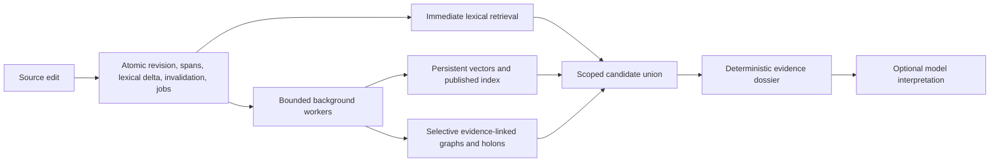

# TRACE-LITE direction assessment and steering plan

Date: 2026-09-12. Deliverable: architectural assessment and proposed steering, not implementation authorization or qualification.

Basis: supplied history; current source inspection at HEAD `0df044b51fb3b40ca3360ea7abd78ac36924b9f8` with substantial tracked and untracked program changes; R08 review, R09 delivery/amendments/rerun log, INT-3 delivery, and accepted ARCHITECTURE.md. No benchmark or runtime verification was executed for this assessment. Historical measurements below were checked against local records, not remeasured. The working tree is not an immutable release candidate.

The direction is worth continuing. The current execution model needs substantial repair. Preserve durable evidence, scoped retrieval, explicit uncertainty, and optional reusable semantic structure. Make expensive interpretation incremental and independently scheduled. Neither a wholesale rewrite nor a retreat to query-time-only RAG is justified by the evidence.

## What the proposed audit gets right and wrong

| Claim | Assessment |
|---|---|
| Source fidelity, conflict coexistence, and independent retrieval are valuable | Agree. Byte fidelity establishes quotation identity, not truth, semantic support, or complete retrieval. |
| The vision is 80% correct and implementation 60% flawed | Unsupported precision. Use demonstrated capabilities and unresolved hypotheses instead. |
| SQLite has reached a structural dead end | Not established. Current application algorithms perform corpus-scale work and block requests. Isolate those costs before attributing a storage-engine limit. |
| Every query should avoid backlog scans and rebuilds | Agree. This is an immediate architecture requirement. |
| Remove the outbox | Disagree. Durable work intent is useful for atomic replacement and restart. Repair scheduling and granularity. |
| Replace freshness with two latest-sequence values | Insufficient. Out-of-order completion, failed jobs, deletions, and configuration changes can leave holes below the maximum completed sequence. |
| Perform all semantic extraction at query time | Too strong. Keep cheap structural facts; materialize useful semantic work selectively. Query-time extraction cannot recover relevant counterevidence excluded from top-K. |
| sqlite-vec and USearch are interchangeable persistent ANN solutions | Not established. Evaluate exact KNN and ANN separately, including mutation, Windows packaging, filters, persistence, and recovery. |
| 10k–50k is the true final scale | A reasonable initial release envelope, not a user-validated ceiling. Keep 1M as a later capacity objective. |
| Searchable in <10ms and sub-15ms dossiers | Unmeasured aspirations. Separate durable ingest, lexical visibility, vector publication, retrieval, and optional model synthesis. |
| The pivot is the global optimum | Unsupported. Compare alternatives under the same workloads and resource budgets. |

SQLite WAL supports concurrent readers and one writer; that supports testing short transactions and independent compute before replacement: [SQLite WAL documentation](https://www.sqlite.org/wal.html). Vector candidates expose different contracts: [sqlite-vec KNN documentation](https://alexgarcia.xyz/sqlite-vec/features/knn.html), [USearch documentation](https://github.com/unum-cloud/usearch). Neither library alone provides TL's cross-store publication protocol.

## Findings that change the plan

1. **The accepted architecture already describes much of the needed repair.** ARCHITECTURE.md section 3 separates durable/lexical acknowledgement from background extraction and encoding. It specifies bounded transactions, version checks, and base-plus-delta reads. `source/project.py` instead explicitly implements bounded synchronous drain on writes. This is partly implementation divergence, not a failed thesis.

2. **Read complexity is visibly unbounded by result count.** `pending_coverage()` fetches all current revisions with correlated checks before applying its output cap in Python. `_vector_search()` also loads every live atom ID per query. A returned list of 64 revisions or ten hits does not bound database work.

3. **Publication is coupled to corpus re-encoding.** `api/app.py::_ensure_served_vector()` calls `cascade.py::refresh_served_vector()` on a reader generation change. That function loads and re-encodes the corpus. It disables the served vector branch above 20,000 atoms. A 50k-note hybrid claim therefore requires a behavior change, not just a faster benchmark.

4. **Semantic integration is weaker than the target capability.** The served projection code describes one pipeline-maintained corpus thematic holon. Membership proves grouping plumbing; it does not prove selective cross-source reconciliation, useful overlapping subgraphs, or improved evidence assembly. The structural extractor is an explicit regex baseline. Its general semantic accuracy remains a separate evaluation question.

5. **Learned retrieval has encouraging but bounded evidence.** INT-3 reports paired nDCG improvements of +0.0397 on SciFact and +0.1077 on NFCorpus; FiQA uses a 5k-document sample. Cold queries cost 436–770 seconds. That supports preserving the encoder experiment and fixing serving. Its bulk-loaded corpus and nine insufficient/empty dossier probes do not prove integrated semantic utility or broad dossier integrity. Scratch-only evaluation scripts also weaken reproducibility.

6. **R09 is not a clean production qualification.** Its canonical delivery says 2k CONDITIONAL, with latency/publication/quality caveats; the earlier 10k record was invalidated by operator error. The clean rerun log records 237.7 to 38.4 docs/s across chunks and 256 jobs drained at 2.238/s, with no completed verdict in that log. 100k and above are recorded as unrun. Do not repeat the historical claim that 100k was underway as verified fact.

7. **The evaluation rules need correction.** Amendment section N treats a CI covering a historical reference minus a margin as non-inferiority; the harness uses absolute point-estimate distance. Neither establishes paired non-inferiority on matched data. Sampled drain triggered by replay requests establishes progress when driven, not autonomous eventual completion or stability under arrivals. Flexible budgets permit diagnostics, not a production PASS with failed utility requirements.

8. **The coordination method contributed to the failure.** Component PASS labels preceded runtime integration; mutable candidate labels were reused; static batch checks missed native failures; evidence was overwritten; progress percentages obscured open-ended qualification. Retain independent verification, but make the unit of progress a reproducible user-visible capability. Do not infer native speedups from OS names: several measured WSL databases were on ext4, not the mounted repository filesystem.

## Target execution model

The dossier remains useful without an LLM. It carries exact citations, snapshot identity, omitted coverage, unresolved relations, and counterevidence. Optional model interpretation is labeled, versioned, evidence-linked, and independently invalidatable.

Keep source truth authoritative in SQLite initially. Commit revision replacement, lexical visibility, invalidation intent, and durable jobs coherently. Execute extraction/encoding outside writer transactions. Recheck dependency versions at publication. Retain an older compatible index plus bounded deltas; suppress deleted/superseded evidence through scoped visibility checks. A stalled semantic worker must not block ordinary lexical retrieval.

Persist embedding outputs keyed by content and encoder/configuration identity, while preserving distinct source occurrences. Fixed-model unchanged content should not be re-encoded after unrelated edits. The hashbow baseline has corpus-dependent IDF: freeze its representation per generation or explicitly rebuild it in the background. Appending vectors while silently changing IDF is incorrect.

## Ordered steering packets

| Packet | Deliverable | Exit condition |
|---|---|---|
| S0: Reconcile evidence | Immutable candidate manifest; capability ledger; preserved attempt directories; one controlling evaluation revision | Every claim names code, harness, data, configuration, and evidence; diagnostic vs qualified status explicit |
| S1: Correctness and measurement | Real native server/load-client harness; immutable run IDs; missing-DB fail-closed behavior; matched quality baseline | Ingest/edit/delete/restart and stale-worker tests pass; deliberate blocking and corrupt/missing evidence cause expected failures |
| S2: Bounded reads | Materialized per-revision/per-stage/configuration coverage; transactionally maintained counters; scoped indexed visibility lookups | Query execution does not scan all revisions, queued jobs, or live IDs; sampled reconciliation independently validates metadata |
| S3: Independent maintenance | Supervised worker lifecycle, bounded batches, leases, retry/backoff, backpressure; shared online/bulk correctness primitives | Jobs finish without user replay requests; restart resumes; workers cannot publish obsolete results; writer progress and queue lag measured |
| S4: Persistent vector serving | Cached embeddings; separate vector generation; shared published base with bounded delta/tombstones; controlled compaction | A one-source edit encodes only changed content; first query never triggers corpus build; crash at each publication boundary recovers coherently |
| S5: Prove semantic value | Matched flat-hybrid, structural-expansion, selective-graph/holon, and bounded query-time-interpretation arms | Added complexity improves evidence completeness/qualifier retention or reduces repeated work at equal correctness and measured cost |
| S6: Qualify release envelope | Native 2k then 10k then 50k full lifecycle and sustained-write runs; larger rungs only after admission | Quality, latency, publication, recovery, memory, disk, and writer-progress requirements met on the same candidate/configuration |

S1 must specifically cover the recorded retract/invalidate crash window, wrong claimed revision IDs, interior byte offsets, excluded relation endpoints, and invalid members of atomic evidence groups. These remain audit targets until rerun on the pinned candidate, regardless of earlier component verdicts.

S2 coverage state must distinguish not-required, pending, complete, failed, superseded, and incompatible configuration. Maintain a contiguous completed frontier only where needed, plus explicit holes and per-stage state. A maximum completed ID cannot certify coverage. Exact diagnostic scans belong in bounded maintenance, not every query.

S3 profiling should separate parsing, SQL lookup, grouping, transaction commit, checkpoint, encoding, and publication costs at several small corpus sizes. Inspect query plans and rows touched. A document is not a job: report spans/document, jobs/revision, memberships/span, revision churn, and bytes. Require measured service capacity above the chosen arrival load, plus an actual finite-backfill drain. A positive sample rate alone is insufficient.

S4 compares the existing persisted adapter, an exact vector baseline, and a persistent ANN candidate on cached identical vectors. Choose by filtered recall, cold/warm latency, update cost, disk/RAM, Windows support, and recovery. Check disk capacity for old/new generations and WAL simultaneously. Background full rebuild can be a transitional repair; repeated full re-encoding must not be the steady-state edit strategy.

S5 includes questions requiring evidence outside the first lexical/vector top-K, conditional disagreement, quantities, actor reversal, and source updates. Measure unsupported relation rates and missing counterevidence, not merely relation counts. Keep rules for explicit syntax; abstain on uncertain semantics. Promote costly semantic structures selectively when reused and useful. R08 stays parked; its small repair experiment does not disprove learned repair generally.

S6 uses development runs to propose budgets, freezes them before fresh confirmation, and reports p50/p95/p99 including queueing and generation changes. Use paired quality differences on identical queries/corpus; establish non-inferiority from the lower confidence bound against a prespecified margin. Include exact ANN neighbors as a separate test. Keep bulk import and online mutation operating points distinct. Start 100k/250k/1M only when measured curves and physical host headroom justify them. 10M remains an unqualified capacity hypothesis.

## Decision and stopping rules

Continue TL under this repaired execution model. Preserve existing databases, source contracts, useful modules, and failed evidence. Do not restart R00–R09 or replace the database preemptively. Do not run another expensive ladder merely to reconfirm already visible scaling defects.

If bounded transactions and incremental maintenance still saturate the writer at the required workload, evaluate separating derived storage or a different backend using the measured bottleneck. If graph/holon enrichment fails matched utility tests, keep it optional and ship the simpler evidence substrate. If selective materialization wins, expand it under explicit CPU, storage, and freshness budgets.

The next release claim should be: a reproducible, useful evidence-memory system within a measured operating envelope. Document counts, passing unit tests, and historical progress percentages are not substitutes for that result.
